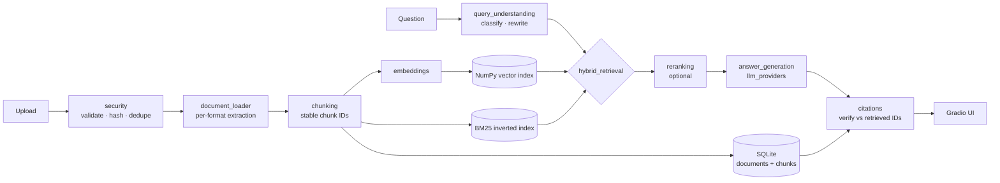

# KnowledgeOS AI

**Your Intelligent, Evidence-Grounded Knowledge Workspace.**

KnowledgeOS AI is a retrieval-augmented generation (RAG) application for working with your own documents.
Upload PDFs, Word files, spreadsheets and notes; search them with keyword, semantic or hybrid retrieval;
ask questions and get answers in which every claim cites the passage it came from; and measure retrieval
quality with a built-in evaluation lab. It runs in Google Colab with free resources and works without any
API key (it then shows evidence instead of generated answers).

## Features

| Area | What it does |
|---|---|
| Ingestion | PDF, DOCX, TXT, Markdown, CSV, XLSX with format-specific extraction; page/sheet/section metadata; size and type validation; content-signature checks; SHA-256 duplicate detection; empty-document and text-quality checks; optional OCR |
| Processing | Unicode/whitespace normalisation; paragraph → sentence → word-window chunking; token-aware sizes (embedding tokenizer) with a character fallback; overlap; stable chunk IDs |
| Retrieval | Dense (embeddings), keyword (BM25), hybrid (Reciprocal Rank Fusion), hybrid + cross-encoder reranking with automatic fallback; multi-query; document filters; relevance floors; duplicate-passage removal |
| Answers | Pluggable providers (none, OpenAI-compatible, Gemini, local Hugging Face); streaming; evidence budgeting; conversation-aware question rewriting; greeting/meta detection |
| Evidence | Citations mapped to the exact retrieved chunk; unverifiable markers flagged; evidence panel with ranking and scores; honest "not enough evidence" replies |
| Research | Summaries, section summaries, multi-document comparison, concept explanation, study notes, flashcards, quizzes, reports, pros/cons, key terms (TF-IDF), evidence extraction |
| Evaluation | Precision@K, Recall@K, MRR, Hit@K, latency; answer token-F1, citation validity, evidence coverage, optional LLM-judge, cost estimates; strategy comparison across runs; CSV/JSON export |
| Operations | Structured JSON logs with request IDs and secret redaction; diagnostics report; index health check and repair; settings UI; optional Google Drive backup |

## Architecture



See `docs/ARCHITECTURE.md` for the full data flow and design decisions.

### What is machine learning and what is not

| Component | Kind |
|---|---|
| Embeddings (bge-small), cross-encoder reranker, LLM answers / rewriting / research outputs, LLM-judge | Machine learning (pre-trained models; nothing is trained here) |
| BM25, Reciprocal Rank Fusion, TF-IDF key terms, cosine search, evaluation metrics, lexical citation support | Conventional algorithms |
| Ingestion, chunking rules, citation verification, storage, sessions, UI, security checks | Application logic |

## Technology

Python 3.10+ · Gradio 4.44–5.x · sentence-transformers · NumPy · SQLite · pypdf · python-docx · openpyxl ·
pandas · requests · pytest. Default embedding model `BAAI/bge-small-en-v1.5`; default reranker
`cross-encoder/ms-marco-MiniLM-L-6-v2`.

## Running in Google Colab

Run the notebook cells **in order**, each in its own Colab cell (`%%writefile` must stay on line 1).

| Cells | Purpose |
|---|---|
| 01 | Install dependencies |
| 02–08 | Project skeleton, configuration, schemas, logging, security + validation |
| 09–14 | Text processing, loaders, chunking, test fixtures + validation |
| 15–21 | Embeddings, SQLite store, vector index, BM25, reranking, hybrid retrieval + validation |
| 22–27 | LLM providers, query understanding, citations, answer generation + validation |
| 28–33 | Research tools, conversations, service layer + validation |
| 34–37 | Evaluation, diagnostics, UI components + validation |
| 38–49 | UI controllers and all eight pages + validation |
| 50–56 | App assembly and the automated test suite |
| 57–60 | Requirements, README and documentation |
| 61 | Integration check |
| 62 | Package the source as a ZIP with a measured size report |
| 63 | Optional: Google Drive backup / restore |
| 64 | **Launch** the app |
| 65 | Stop the app |

Validation cells (08, 14, 21, 27, 32–33, 37, 42, 49, 56, 61) print what they verified; if one fails,
fix or re-run the cell that creates the reported file, then re-run the validation cell. Cells that use
`%%writefile -a` (11, 23, 31) append to the file created by the cell before them: re-run both, in order.

Launching (CELL 64) prints a link. `SHARE = False` keeps the app inside the notebook; `SHARE = True` creates a
public Gradio link (read the security section first).

## Configuration

All settings are editable on the **Settings** page and saved to `<data_dir>/settings.json`.
`config/settings.example.json` lists every option with its default. Changing the embedding model or the
chunking settings requires **Document Library → Re-index all**.

## LLM providers

| Provider | Setup |
|---|---|
| `none` (default) | Nothing to set up. Questions return the most relevant passages with citations. |
| `openai_compatible` | Base URL (e.g. `https://api.openai.com/v1` or another OpenAI-style endpoint), model name, API key |
| `gemini` | Google AI Studio API key, model name |
| `local_hf` | Hugging Face model id (default `Qwen/Qwen2.5-0.5B-Instruct`); slow on CPU |

Keys can be entered on the Settings page (memory only) or set before launch:
`os.environ["KOS_OPENAI_API_KEY"] = "..."` / `os.environ["KOS_GEMINI_API_KEY"] = "..."`.
Use **Test provider** on the Settings page to confirm a configuration.

## Security

- API keys are held in process memory or environment variables only; never written to settings, logs,
  diagnostics or the source ZIP. Logs pass through a secret-pattern redactor (defence in depth).
- Uploads are validated by extension, size and content signature, stored under a per-document folder
  with sanitised names, and never executed.
- Uploaded text is treated as untrusted: it is wrapped as evidence, tag-spoofing is neutralised, the model is
  told not to follow embedded instructions, and suspicious passages are flagged. This reduces prompt-injection
  risk; it does not eliminate it.
- **Public share links have no login.** Anyone with the link can use the app, search the shared document
  library and spend your LLM quota. Conversations are isolated per browser session, but documents are shared.
  Do not share links while confidential documents are loaded; stop the app when finished.
- Colab runtimes are temporary. Data is lost when the runtime ends unless you back it up to Drive (CELL 63).

## Evaluation methodology

Retrieval metrics are deterministic and computed against your relevance labels (chunk IDs, document IDs or
keywords, in that order of precedence). Answer metrics (token-F1, citation validity, evidence coverage) are
deterministic but limited; the optional LLM-judge score is model-based and labelled as such. Small question
sets cannot show that one strategy is better than another. See `docs/EVALUATION.md`.

## Known limitations

- Exact (brute-force) vector search: fine for tens of thousands of chunks, not millions.
- BM25 tokenisation and the default embedding model are English-focused.
- "Verified" citations prove the passage was retrieved and shown to the model, not that it entails the claim.
- OCR is optional and needs extra packages; complex PDF layouts (multi-column, tables) may extract imperfectly.
- The default local LLM is small; hosted providers give better answers.
- No user accounts or authentication; not intended for multi-user production use as is.

## Troubleshooting

| Symptom | Fix |
|---|---|
| A cell says a file is missing | Re-run the cell that creates it (see the table above) |
| "Dense search skipped" warning | The embedding model changed; Document Library → Re-index all |
| Document shows `failed` | Open it in the Library to see why (e.g. scanned PDF → enable OCR) |
| No answers, only passages | No provider configured; see LLM providers |
| Out of memory | Lower embedding batch size; avoid `local_hf`; process fewer files at once |
| Port already in use on launch | Run CELL 65, then CELL 64 again |

## Project structure

```
knowledgeos/            core package (config, ingestion, retrieval, generation, services, …)
knowledgeos/ui/         Gradio pages + Gradio-free controllers (unit-testable)
tests/                  pytest suite and synthetic fixture generator
docs/                   architecture, evaluation notes, case-study template, test report
config/                 settings example (no secrets)
```

## Tests

`python -m pytest -q` from the project root (CELL 56 does this and saves `docs/test_report.txt`).
Tests use a hash-based embedder and mock LLMs, so they need no downloads, GPU or API keys; they verify
application logic, not model quality.

## Exporting the source

CELL 62 builds `knowledgeos_ai_source.zip` (source + docs only, no data, caches or credentials), writes a
manifest with file sizes and SHA-256 hashes, reports the measured source size separately from the ZIP size,
and verifies the archive opens.

